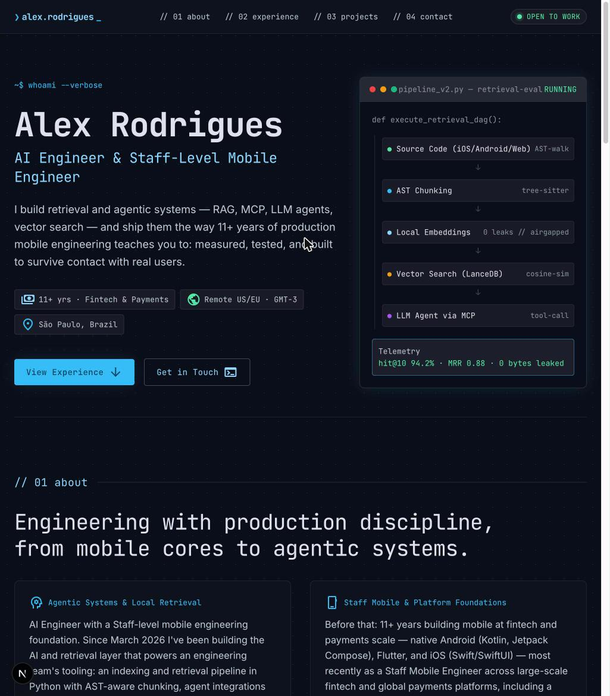
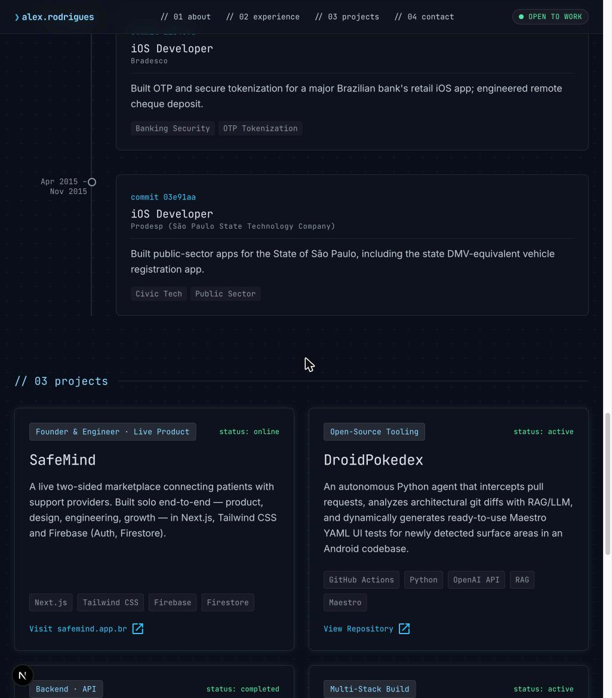

# Alex Rodrigues Portfolio


Alex Rodrigues is a Senior/Staff Mobile & AI Engineer (iOS, Android, Flutter, Kotlin Multiplatform, RAG/LLM/retrieval engineering) who shares his professional journey and projects through a single-page portfolio website.




## Tech stack

- Next.js 16 (Pages Router)
- React 19
- TypeScript 5
- Tailwind CSS v4 (CSS-based `@theme inline` tokens in `styles/globals.css`, no tailwind.config.js)
- Vitest + Testing Library
- ESLint (`eslint-config-next`) + Prettier (`prettier-plugin-tailwindcss`)
- clsx + tailwind-merge via a `cn()` helper

## Getting started

```bash
npm install
npm run dev
npm run build
npm run start
```

Lint: `npm run lint`  
Format: `npm run format`  
Typecheck: `npm run typecheck`  
Test: `npm run test`

## Project structure

```
components/
  layout/     Nav, Footer, TerminalBox
  sections/   Hero, About, Experience, Projects, Contact
  cards/      SkillCard, TimelineItem, ProjectCard
data/
  content.ts  all site copy/links as typed exports (single source of truth)
pages/
  _app.tsx, _document.tsx, index.tsx
styles/
  globals.css   Tailwind v4 theme tokens ("Terminal Blue")
utils/
  cn.ts         clsx + tailwind-merge helper
```

## Design

The site adopts a dark "Terminal Blue" theme: deep blue-black background, sky-blue accents, and a terminal-style aesthetic. Headlines and labels use JetBrains Mono, while body text is rendered in Inter. Visual motifs include macOS-style window chrome, a blinking caret, and classic command-prompt symbols ($ / ❯).